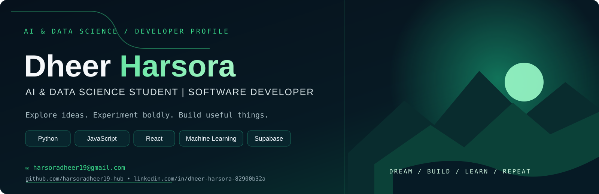

  
  
  

---

## `01 / ABOUT`

> **AI & Data Science student focused on building practical software.**

I'm an undergraduate B.Tech student exploring AI-powered applications, data-driven solutions, and web development. I enjoy taking an idea from a rough concept to a working prototype, especially through team projects and hackathons.

- 🎓 Studying **Artificial Intelligence & Data Science**
- 🧪 Exploring **machine learning, generative AI, and data analysis**
- 🛠️ Building projects across **AI, web apps, and real-world problem solving**
- 🤝 Open to **internships, collaborations, and learning opportunities**

## `02 / TECH STACK`

  Icons represent technologies I've used or am actively learning; experience levels vary.

## `03 / FEATURED BUILDS`

<table>
<tr>
<td width="50%" valign="top">

### 🌱 Kisan Sarthi
**Farmer Advisory Application**

Crop recommendations, weather guidance, a rule-based question flow, and a path to expert support.

[↗ View repository](https://github.com/harsoradheer19-hub/Kisan_Sarthi)

</td>
<td width="50%" valign="top">

### 🧬 EvolveX
**AI Research Environment**

A materials-science research workflow concept focused on ML experiments, reproducibility, and research analysis.

[↗ View repository](https://github.com/harsoradheer19-hub/evoresearch)

</td>
</tr>
<tr>
<td width="50%" valign="top">

### 🛣️ RoadSafe AI
**Road Safety Web Application**

A web project exploring AI-assisted image analysis and road-safety insights.

[↗ View repository](https://github.com/harsoradheer19-hub/Roadsafe-)

</td>
<td width="50%" valign="top">

### 💻 Portfolio & Mini Projects
**Web Development**

A portfolio, task-list app, and Tic-Tac-Toe project built while strengthening web fundamentals.

[↗ Portfolio](https://harsoradheer19-hub.github.io/Portfolio-Web/) · [↗ To-Do List](https://harsoradheer19-hub.github.io/To_Do_LIST/) · [↗ Tic-Tac-Toe](https://github.com/harsoradheer19-hub/Tic_Tac_Toe)

</td>
</tr>
</table>

## `04 / GITHUB ANALYTICS`

## `05 / STARRED REPOSITORIES`

A few repositories I've starred across AI, hackathons, energy, and other project ideas.

- [Kisan Sarthi](https://github.com/harsoradheer19-hub/Kisan_Sarthi) · [EvolveX](https://github.com/harsoradheer19-hub/evoresearch)
- [vibecode-code4cause](https://github.com/harsoradheer19-hub/vibecode-code4cause) · [insureflow](https://github.com/harsoradheer19-hub/insureflow)
- [hybrid-energy](https://github.com/harsoradheer19-hub/hybrid-energy) · [twinos.](https://github.com/harsoradheer19-hub/twinos.)
- [Sovereign-Agentic-AI](https://github.com/harsoradheer19-hub/Sovereign-Agentic-AI) · [chandrayaan-2](https://github.com/harsoradheer19-hub/chandrayaan-2)

## `06 / LET'S CONNECT`

**Have an interesting idea or project? Let's connect.**

 

Build boldly · Learn continuously · Iterate often

